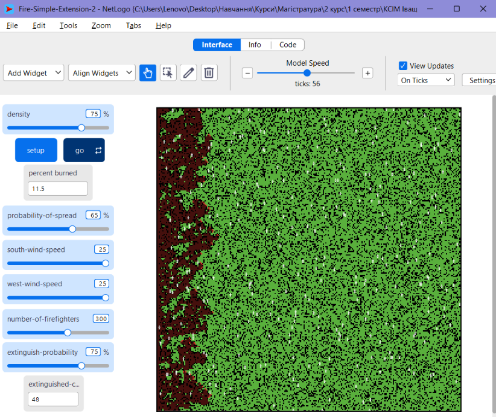

## Комп'ютерні системи імітаційного моделювання
## СПм-25-1, **Ткаченко Тетяна Андріївна**
### Лабораторна робота №**2**. Редагування імітаційних моделей у середовищі NetLogo

 

### Варіант 5, модель у середовищі NetLogo:
[Fire Simple Extension 2](https://www.netlogoweb.org/launch#http://www.netlogoweb.org/assets/modelslib/IABM%20Textbook/chapter%203/Fire%20Extensions/Fire%20Simple%20Extension%202.nlogo)

 

### Внесені зміни у вихідну логіку моделі, за варіантом:
 
**Додано агентів-"пожежників"**, кількість яких вказується користувачем через слайдер number-of-firefighters в інтерфейсі. Для їхнього створення в кінець процедури setup додано виклик нової процедури та обнулення лічильника загашених ділянок:
<pre>
set extinguished-count 0
setup-firefighters
</pre>
 
**Початкове розміщення пожежників тільки на "пустих" ділянках** (там, де немає дерев) випадковим чином, по одному на ділянку:
<pre>
to setup-firefighters
  let free-patches patches with [ pcolor = black ]
  set-default-shape turtles "person"
  create-turtles number-of-firefighters [
    set color white
    set size 3
    set heading one-of [ 0 90 180 270 ]
    ;; по одному пожежнику на ділянку
    move-to one-of free-patches with [ not any? turtles-here ]
  ]
end
</pre>
 
**Випадкове переміщення пожежників тільки по тих ділянках, що поки що не згоріли** (зеленого або чорного кольору):
<pre>
to move-firefighter
  let target patch-ahead 1
  let can-go? false
  ;; чи можна йти вперед (ділянка не згоріла і вільна)
  if target != nobody [
    set can-go? ([ pcolor = green or pcolor = black ] of target) and not any? turtles-on target
  ]
  ;; вибір нового напрямку серед вільних сусідів
  if (not can-go?) or (random 100 < 20) [
    set target one-of neighbors4 with [
      (pcolor = green or pcolor = black) and not any? turtles-here
    ]
    if target != nobody [ face target ]
  ]
  ;; якщо йти нікуди - пожежник стоїть на місці
  if target != nobody [ move-to target ]
end
</pre>
Пожежник рухається прямо, доки попереду є вільна ділянка, а з імовірністю 20 % на такті (або якщо рухатися прямо неможливо) обирає випадкового сусіда з чотирьох. Червоні та темно-червоні (згорілі) ділянки для руху недоступні, на одній ділянці не може бути двох пожежників. Якщо рухатися нікуди, пожежник залишається на місці.
 
**Гасіння вогню при зустрічі пожежником джерела розповсюдження вогню** (червоної ділянки). Палаюча ділянка в чотирьох сусідніх клітинках або під самим пожежником (вогонь міг перекинутися на ділянку, де він стоїть) гаситься і стає чорною:
<pre>
to extinguish-fire
  ask (patch-set patch-here neighbors4) with [ pcolor = red ] [
    ;; гасіння вдається з заданою ймовірністю
    if random-float 100 < extinguish-probability [
      set pcolor black
      set extinguished-count extinguished-count + 1
    ]
  ]
end
</pre>
 
**Зміни в процедурі go.** На кожному такті спочатку діють пожежники (рух та гасіння), після цього вогонь поширюється за вихідною логікою, яка не змінювалася:
<pre>
ask turtles [
  move-firefighter
  extinguish-fire
]
</pre>
 
 

### Внесені зміни у вихідну логіку моделі, на власний розсуд:
 
**Додано ймовірність успішного гасіння**. Пожежник не завжди встигає загасити вогонь за один такт. Імовірність встановлюється користувачем через інтерфейс середовища моделювання (слайдер extinguish-probability, від 0 до 100 %) та використовується в процедурі extinguish-fire:
<pre>
to extinguish-fire
  ask (patch-set patch-here neighbors4) with [ pcolor = red ] [
    ;; гасіння вдається з заданою ймовірністю
    if random-float 100 < extinguish-probability [
      set pcolor black
      set extinguished-count extinguished-count + 1
    ]
  ]
end
</pre>
 
**Додано лічильник загашених ділянок**, який виводиться користувачеві на моніторі інтерфейсу. Для цього додано глобальну змінну:
<pre>
globals [
  initial-trees        ;; how many trees (green patches) we started with
  extinguished-count   ;; кількість загашених пожежниками ділянок
]
</pre>
 
Пожежники відображаються білим кольором збільшеного розміру (форма "person"), щоб їх було видно і на зеленому, і на чорному тлі.
<pre>
set-default-shape turtles "person"
  create-turtles number-of-firefighters [
    set color white
    set size 3
    ...
]
</pre>
 
 

 
Фінальний код моделі та її інтерфейс доступні за [посиланням](fire-firefighters.nlogo).
 
